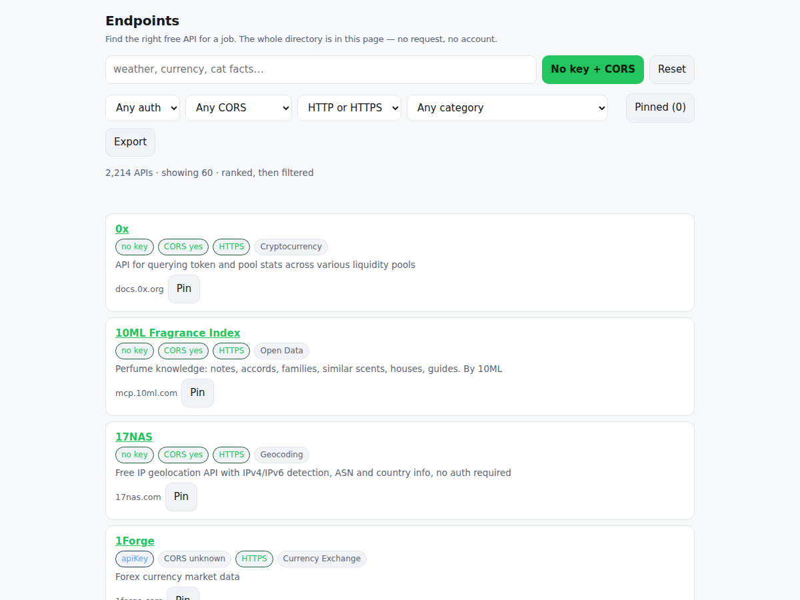

# app-endpoints

<!-- shot:start -->



<!-- shot:end -->

[](https://drsamonline.github.io/app-endpoints/)
[](https://github.com/drsamonline/app-endpoints/releases/latest)
[](test-node.js)
[](LICENSE)

**Find the right free API for a job — offline, with the CORS and auth answers a directory usually
makes you guess** — no accounts, no telemetry, no network at runtime.

Open it: <https://drsamonline.github.io/app-endpoints/play/> · About it: <https://drsamonline.github.io/app-endpoints/>

## Why it exists

Every API directory is a list you read. But three questions decide whether an API is usable before
you write a line — **does it need a key**, **can a browser call it at all** (CORS), and **is it
HTTPS** — and in most lists those are footnotes. Here they are filters. The filter is the product.

The idea surfaced three times independently (the open-data survey, the learn-to-code survey, the
productivity-tools survey) before it was built, which is the strongest signal the queue has. It is
**master list #134**; the first commit's message cites #154, which is wrong — this app was already on
the list with a spec, and the backlog's P5 line for it was a duplicate.

**What this is not.** The spec asked for a rate limit on every entry. The source does not state rate
limits, so none are recorded — the app says "listed as free in public-apis" and links out rather than
inventing one. There is no "try it" call, and no URL was checked for liveness: this is a directory,
not a monitor. `QUEUE/app-endpoints.md` in forge records each of these as not built.

## What is here

| File | What it is |
| --- | --- |
| `docs/play/endpoints.js` | the engine — `validate`, `search`, `stats`, `savePins`, `loadPins`; pure, no DOM, no request |
| `docs/play/app.js` | the UI — wires inputs to the engine and nothing else |
| `docs/play/data.js` | the bundled directory, **generated** from `data/apis.json` by `tools/build-data.py` |
| `data/apis.json` | the record: 2,214 entries plus the source, licence and fetch date in `meta` |
| `data/SOURCE.md` | where the data came from, its licence, and every curation step with its count |
| `docs/play/search-kit.js`, `export-kit.js` | the kits, copied in, so it runs from `file://` |

## The dataset

2,214 public APIs from the **public-apis** README table — **MIT**, fetched **2026-11-10**.
1,103 need no key; 943 allow CORS; 51 categories. `data/SOURCE.md` records the source, the licence,
the fetch date and every change made to the table, with counts. No free-tier terms are recorded,
because the source does not state them — the app links out and says so rather than inventing them.

`docs/play/data.js` and `data/apis.json` are checked to agree entry for entry by the test suite, so
the bundle cannot drift from the record it claims to be.

## What it does when things go wrong

- **Bad input** — an unknown `auth`, `cors`, `https` or category is refused with the vocabulary it
  accepts, and no result set is produced, so the screen keeps its previous list. A search that
  matches nothing names the filters that emptied it.
- **No network** — nothing changes: the directory is in the page and there is no request to fail.
- **Storage full or unavailable** — a pin that cannot be written is reported as **not kept**, with
  the reason, and still works for the session.
- **Corrupt saved state** — reported as corrupt with an excerpt and a reset; never rendered as
  "you have no pins".

## Test it

```sh
node test-node.js      # 101 assertions, no dependencies, no browser
```

The suite is mutation-tested: removing the auth filter turns 6 red, reporting a corrupt save as
empty turns 3 red, reporting a full disk as saved turns 1 red, and swallowing a bad filter turns 7
red.

## Licence

PolyForm Noncommercial 1.0.0 · © 2026 Dr Sohil Momin. The **dataset** is MIT and carries its own
notice — see `data/SOURCE.md`.
